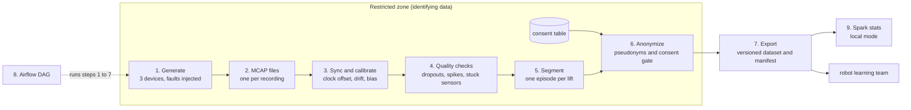
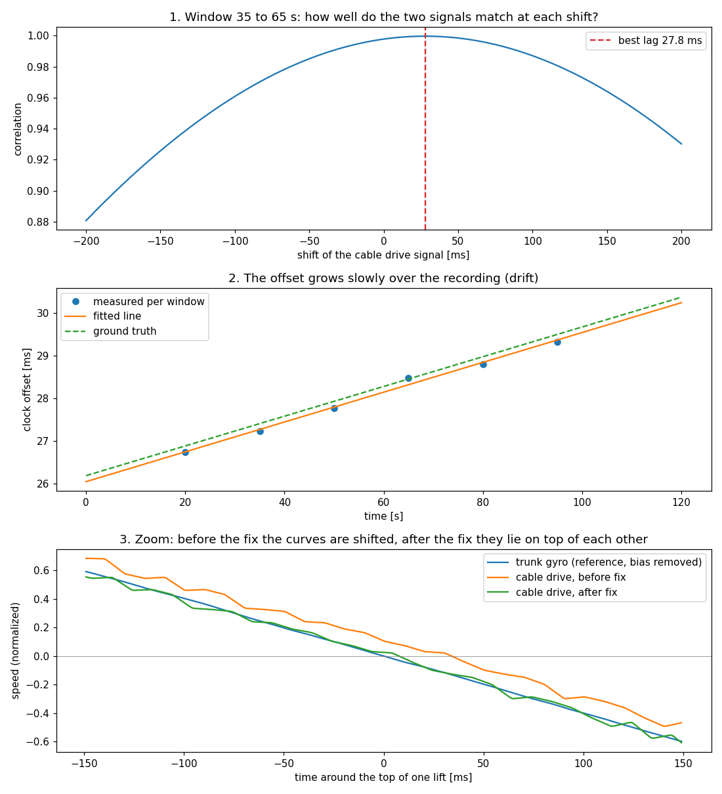
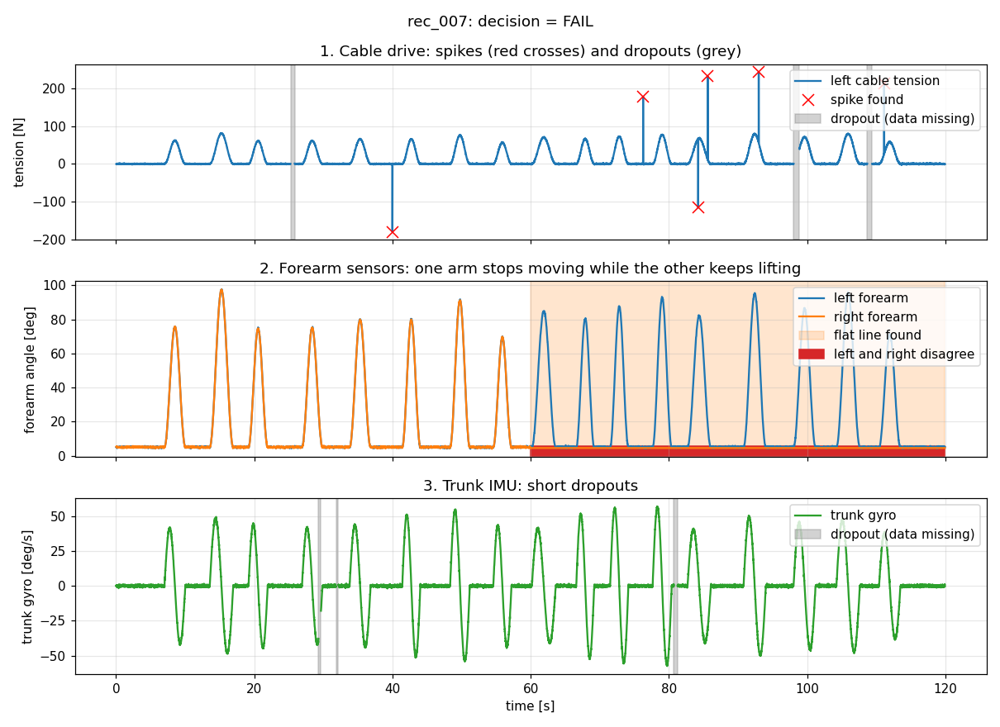
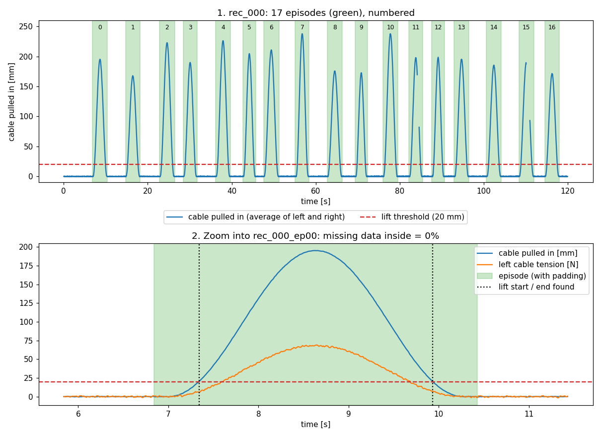

# exo-pipeline-lite

A small, local data pipeline for **synthetic exoskeleton recordings**. It simulates a backpack exoskeleton with motor-driven cables to the forearms, and turns raw recordings from several devices into a clean, anonymized, versioned dataset for robot learning.

> **Honest summary:** all data is synthetic, and the signal set (trunk IMU, cable tension and travel, forearm angles) is my assumption, based on public information about cable-driven exosuits. It is not the data format of any real product. I built this to practice multi-sensor data engineering end to end. Every number below comes from a command in this repository.


## Pipeline



| # | Step | What it does | Code |
|---|---|---|---|
| 1 | Generate | 3 devices with their own sample rates, clock offsets and drift, sensor bias, and injected faults (dropouts, spikes, a stuck sensor). The true values are saved as ground truth | `src/exo/generate.py` |
| 2 | MCAP | one MCAP file per recording, one topic per device, identifying metadata in the file metadata | `src/exo/mcap_io.py` |
| 3 | Sync and calibrate | cross-correlates how fast the worker moves, as seen by two devices, in windows, then fits a line: clock offset and drift. One 100 Hz grid, dropouts stay empty. Bias is measured while the worker stands still | `src/exo/sync.py`, `src/exo/calibrate.py` |
| 4 | Quality checks | dropouts, spikes (neighbor median), frozen sensors, left and right disagreeing. Decision per recording: pass, warn or fail | `src/exo/qc.py` |
| 5 | Segment | one episode per lift, found with a threshold on the cable travel | `src/exo/segment.py` |
| 6 | Anonymize | worker IDs become keyed-hash pseudonyms (HMAC), consent gate, automatic leak check | `src/exo/anonymize.py` |
| 7 | Export | versioned dataset (Parquet), manifest with SHA-256 hashes, `verify` command | `src/exo/export.py` |
| 8 | Orchestrate | Airflow DAG with retries and idempotent tasks | `dags/exo_pipeline_dag.py` |
| 9 | Spark | per-episode statistics in Spark local mode, checked against pandas | `src/exo/spark_stats.py` |


## Quick start

```bash
git clone https://github.com/Pruthvi-Radadiya/exo-pipeline-lite.git
cd exo-pipeline-lite
python3 -m venv .venv && source .venv/bin/activate
pip install -e ".[dev]"
export EXO_PSEUDONYM_KEY="$(python -c 'import secrets; print(secrets.token_hex(32))')"
bash scripts/run_pipeline.sh      # about 1 minute, prints the results at the end
pytest -q
```

Python 3.10 or newer. The pseudonym key is a secret: it is never stored in the repository.

## Running with Docker & Apache Airflow

To run the pipeline as a fully orchestrated, containerized workflow with retries and web UI monitoring:

```bash
# 1. Create .env with your user ID and secret key
echo "AIRFLOW_UID=$(id -u)" > .env
echo 'EXO_PSEUDONYM_KEY="a-secret-passphrase-with-at-least-16-chars"' >> .env

# 2. Build the custom Airflow image (includes numpy, pandas, pyarrow, mcap)
docker compose build

# 3. Start the Airflow cluster in the background
docker compose up -d
```

Open **`http://localhost:8080`** in your browser:
* **Username:** `airflow`
* **Password:** `airflow`
* Trigger the **`exo_pipeline`** DAG to observe the pipeline execution, automated task retries (`check_export_storage`), and dataset generation.

To stop all services:
```bash
docker compose down
```

## Results

20 synthetic recordings (seed 42), scored against the ground truth that the generator saved:

| Stage | Result | Command |
|---|---|---|
| Sync | worst remaining clock error: 0.53 ms (cable drive), 1.24 ms (forearm sensors). Before: 10 to 45 ms offset and up to 70 ppm drift | `python scripts/evaluate_sync.py` |
| Calibration | worst bias error 0.10 (deg/s or N) | `python scripts/evaluate_sync.py` |
| Quality checks | 92 of 93 injected spikes found (2 false alarms, the miss was inside a dropout), 81 of 81 dropouts found, both stuck sensors found. 18 recordings warn, 2 fail | `python scripts/evaluate_qc.py` |
| Segmentation | 308 of 308 lifts found, 0 false alarms, typical error of the lift middle: 1 ms | `python scripts/evaluate_segment.py` |
| Anonymization | 308 episodes in, 51 left out for missing consent, 257 exported, 5 pseudonyms, 0 identifying texts found in the export | `python -m exo.anonymize` |
| Export | 236 episodes and 79,869 frames in 2 Parquet files (4.7 MB). Two exports give identical data files | `python -m exo.export` |
| Spark | same statistics as pandas. Pandas was faster at this size (0.08 s against 5 to 14 s) | `python -m exo.spark_stats --compare` |
| Tests | 58 passed, 1 skipped (the Airflow DAG test runs only where Airflow is installed) | `pytest -q` |

## Visualizations

### 1. Clock Synchronization & Drift Fit (Step 3)
Sliding cross-correlation finds time offsets; linear regression fits clock drift:


### 2. Quality Checks & Fault Detection (Step 4)
Automated detection of injected spikes, dropouts, and stuck sensors:


### 3. Episode Segmentation (Step 5)
Continuous sensor streams segmented into discrete robot learning episodes:



## What went wrong along the way

These bugs taught me the most:

- **Hiding dropouts hurt the sync.** My first version interpolated across missing data. The worst clock error was 7.6 ms. Leaving dropouts empty and ignoring them brought it to 0.5 ms.
- **Averaging a broken sensor hurt too.** Averaging the stuck right forearm with the left one gave 2.9 ms. Using the healthy one gave 1.2 ms.
- **My first spike detector found 2,918 spikes** in a recording that has 3. The median of the neighbors included the sample itself, so the noise estimate collapsed. Scoring against the known faults is what exposed it.
- **Spark treats NaN as the biggest number**, so a plain `max` over a column with NaN returns NaN. I convert NaN to null and have a test for it.
- **I first modeled leg joints,** then switched to forearm cables after reading how these devices work, and rebuilt the signals.

## Limitations

- **Everything is synthetic.** Real human motion and real cable forces are messier. The signal set is an assumption.
- **Thresholds are tuned on synthetic data** (spike limit, 20 mm lift threshold, 5% missing). Real data needs tuning.
- **The consent table is fake.** A real system needs a real consent source, history and proof.
- **Pseudonymized data is still personal data** under the GDPR. Body movement can identify a person, and there are only 5 pseudonyms. See the privacy note.
- **A recording with a stuck sensor is rejected as a whole,** although its first 60 seconds are fine. A better pipeline would keep the good part.
- **No retargeting** of the human motion to a humanoid body, no video, no upload to cloud storage.
- **The export follows the ideas of the LeRobot dataset format** (many episodes per Parquet file, an episode table, `info.json`), but I did not test loading it with the `lerobot` library.
- **Spark ran in local mode only,** never on a cluster.

## Privacy note

Workers' IDs are replaced by keyed-hash pseudonyms. The key table and the original metadata stay in a separate private folder that is never exported. The export step reads only the anonymized table, so episodes of workers without consent never reach the dataset, and an automatic check searches every cell and column name for identifying text before anything is written. This is pseudonymization, not anonymization, and I am not a lawyer: a real project needs a data protection officer, a risk assessment and clear consent rules (for employees in Germany, see also §26 BDSG).

## Repository layout

```
src/exo/            the pipeline: generate, mcap_io, sync, calibrate, qc, segment, anonymize, export, spark_stats
scripts/            evaluation scripts, plots, run_pipeline.sh, a fake consent table
dags/               the Airflow DAG
tests/              pytest tests (they check against the generator's ground truth)
docs/               a few example plots
```

## Optional: Airflow and Spark

- **Airflow:** `dags/exo_pipeline_dag.py` runs steps 1 to 7 with retries. Tested both in local CLI mode and fully containerized with Docker Compose (CeleryExecutor, Redis, PostgreSQL). 
- **Spark:** `pip install -e ".[dev,spark]"` (needs Java 17 or newer), then `python -m exo.spark_stats --compare`.

## License

MIT, see `LICENSE`.